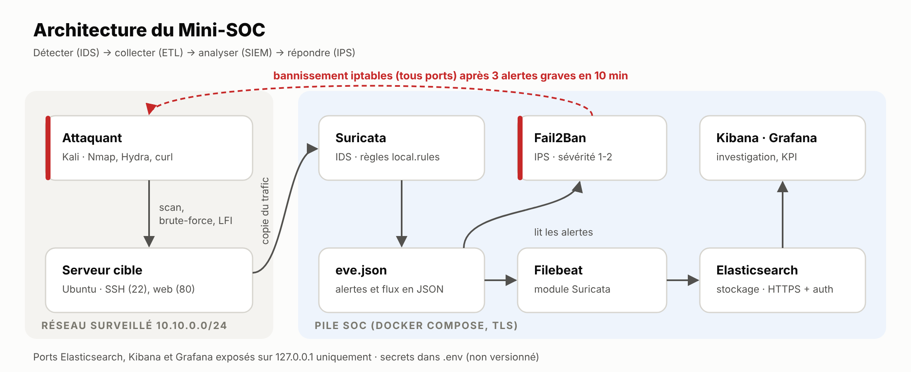
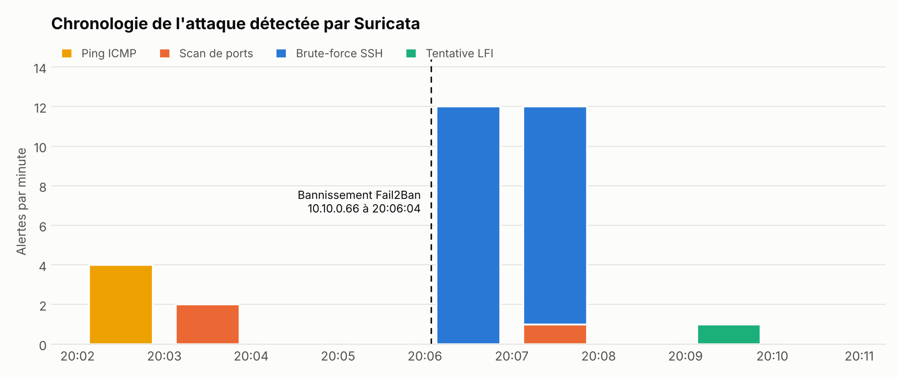
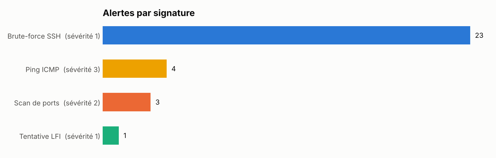
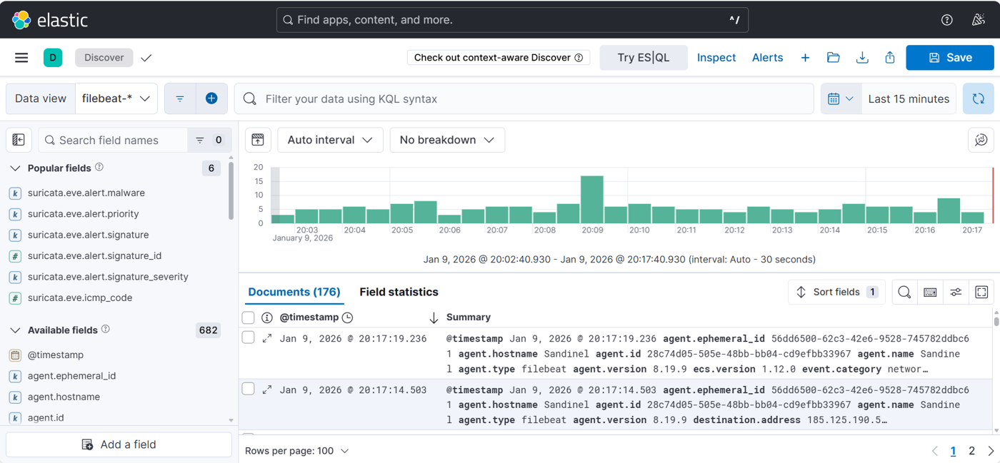
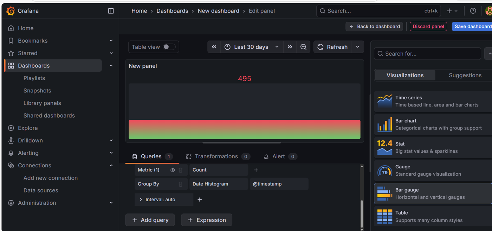

# 🛡️ Mini-SOC – Détection d'intrusions et réponse automatique

[](https://github.com/madjiguenedotesene/mini-soc-suricata-elk/actions/workflows/ci.yml)


Un **centre de supervision de sécurité** open source complet, conçu pendant mon Master Data Science & Cybersécurité (Université Paris 8) : il **détecte** les attaques réseau avec Suricata, **centralise** les événements dans Elasticsearch, les **analyse** dans Kibana et Grafana, et **bannit automatiquement** les attaquants avec Fail2Ban.

> **En une commande**, la démonstration rejoue un scénario d'attaque complet (reconnaissance → scan → brute-force SSH → inclusion de fichier) et produit la chronologie de l'incident et la fiche de réponse, sans attaquer aucune machine.



## 📊 Résultats de la démonstration

| Étape | Résultat |
|---|---|
| Événements réseau analysés | **676** |
| Alertes Suricata | **31**, dont **27** graves (sévérité 1-2) |
| Chaîne d'attaque reconstituée | Ping → scan de ports → brute-force SSH → tentative LFI |
| Délai entre la 1re alerte et le bannissement | **244 s** (bannissement à la 3e alerte grave) |
| Alertes évitées par le bannissement | **24** (fin du brute-force et tentative LFI) |





Fiche d'incident complète : [docs/rapport_incident_demo.md](docs/rapport_incident_demo.md). Les chiffres peuvent varier de quelques alertes d'une exécution à l'autre (fenêtres de seuil de Suricata).

## 🚀 Démarrage rapide

### Option 1 – Démonstration hors ligne (2 minutes)
Prérequis : Linux avec `suricata`, `fail2ban` et Python 3.

```bash
git clone https://github.com/madjiguenedotesene/mini-soc-suricata-elk.git
cd mini-soc-suricata-elk
pip install -r requirements.txt
./demo/run_demo.sh          # résultats dans demo/output/
```

Le script génère une capture réseau du scénario (`demo/generate_pcap.py`), la fait analyser par Suricata, vérifie que le filtre Fail2Ban reconnaît les alertes, puis produit les graphiques et la fiche d'incident. Cette démonstration est rejouée automatiquement à chaque commit par la CI GitHub Actions.

### Option 2 – SOC complet avec Docker
Prérequis : Docker et Docker Compose, 4 Go de RAM libres, une interface réseau à surveiller.

```bash
cp .env.example .env        # renseigner les mots de passe et l'interface (SURICATA_IFACE)
docker compose up -d        # Elasticsearch, Kibana, Suricata, Filebeat, Fail2Ban
docker compose --profile grafana up -d   # optionnel : Grafana
./scripts/check_soc.sh      # état des services, dernières alertes, prison Fail2Ban
```

Kibana : https://localhost:5601 (utilisateur `elastic`). Pour tester la détection depuis une VM attaquante du laboratoire : `./scripts/simulate_attack.sh <ip_cible>`.

## 🔍 Règles de détection

| SID | Menace | Logique | Sévérité | Fail2Ban |
|---|---|---|---|---|
| 1000001 | Reconnaissance ICMP | Ping vers le réseau surveillé | 3 | ignorée |
| 1000002 | Brute-force SSH | > 5 connexions SSH en 60 s par source | 1 | ✅ |
| 1000003 | Scan de ports | > 20 SYN en 10 s par source | 2 | ✅ |
| 1000004 | Inclusion de fichier (LFI) | `../` répété vers `/etc/passwd`, `win.ini`… | 1 | ✅ |

Fichier : [suricata/rules/local.rules](suricata/rules/local.rules).

## ⚡ Réponse active (IPS)

Fail2Ban lit `eve.json` et ne retient **que les alertes de sévérité 1 ou 2** : un simple ping ne bannit personne.

- **3 alertes graves en 10 minutes** → blocage de tous les ports de la source (iptables) pendant 1 h ;
- **récidive** : durée doublée à chaque nouvelle infraction (maximum 1 semaine) ;
- l'infrastructure du SOC et le poste d'administration sont en liste blanche (`ignoreip`).

Configuration : [fail2ban/](fail2ban/) · Procédure d'analyse : [playbook brute-force SSH](docs/playbooks/brute-force-ssh.md) (avec correspondance MITRE ATT&CK T1110.001).

## 🔐 Sécurité de la pile

- **TLS** entre tous les composants Elastic (autorité de certification générée au démarrage) ;
- **authentification** obligatoire, compte `kibana_system` dédié ;
- **aucun secret dans le dépôt** : mots de passe dans `.env` (non versionné, modèle `.env.example`) ;
- interfaces d'administration exposées sur **127.0.0.1** uniquement.

## 🖼️ Captures du TP original (janvier 2026)

| Investigation dans Kibana | Compteur d'alertes dans Grafana |
|---|---|
|  |  |

Le pic visible dans Kibana à 20h09 correspond à l'attaque par dictionnaire lancée avec Hydra pendant le TP.

## 🧭 Ce qui a été amélioré par rapport au TP

| TP (janvier 2026) | Ce dépôt |
|---|---|
| Installation manuelle sur VM | Pile reproductible avec Docker Compose |
| TLS désactivé, mot de passe en clair dans `filebeat.yml` | TLS activé, secrets dans `.env` |
| Bannissement à la 1re alerte, quelle qu'elle soit | Bannissement sur alertes graves uniquement, liste blanche, récidive |
| Démonstration non rejouable | Scénario PCAP rejoué automatiquement en CI |

## ⚠️ Limites et pistes

- La règle de scan compte tous les SYN : un brute-force très rapide peut aussi la déclencher (visible à 20h07 sur la chronologie). Piste : compter les ports distincts côté SIEM.
- Un bannissement par IP est contournable (rotation d'adresses) : à compléter par du durcissement SSH (authentification par clé).
- Pistes : enrichissement par Threat Intelligence (MISP), agents Wazuh pour l'intégrité des fichiers, politique de rétention ILM 12 mois, règles Sigma.

## 🧠 Compétences démontrées

Détection d'intrusions (IDS) · écriture de règles Suricata · SIEM Elastic (ingestion, investigation, tableaux de bord) · réponse automatisée (IPS) · analyse de trafic (Wireshark) · playbook SOC et MITRE ATT&CK · Docker · CI/CD · Python (scapy, analyse de logs, visualisation)

## 📁 Structure

```
├── docker-compose.yml        # pile SOC complète (TLS)
├── suricata/rules/           # règles de détection personnalisées
├── filebeat/                 # collecte de eve.json vers Elasticsearch
├── fail2ban/                 # filtre et prison (réponse active)
├── grafana/provisioning/     # source de données Elasticsearch
├── demo/                     # scénario PCAP, analyse, graphiques
├── scripts/                  # simulation d'attaque (lab) et vérifications
└── docs/                     # architecture, playbook, rapport d'incident
```

## 👥 Auteurs

Projet réalisé en équipe dans l'UE *Sécurité des réseaux* (Université Paris 8) : **Madjiguene SENE**, Youssouf Moussa ALI HAKI, Guindo SADIO. Version reproductible (Docker, démonstration, CI) : Madjiguene SENE.

[LinkedIn](https://www.linkedin.com/in/madjiguene-dote-sene/) · [GitHub](https://github.com/madjiguenedotesene)
